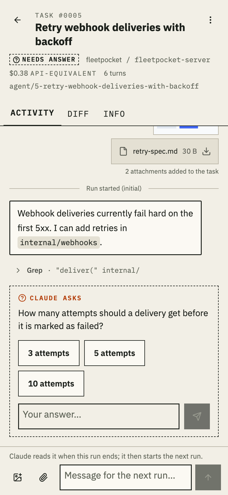
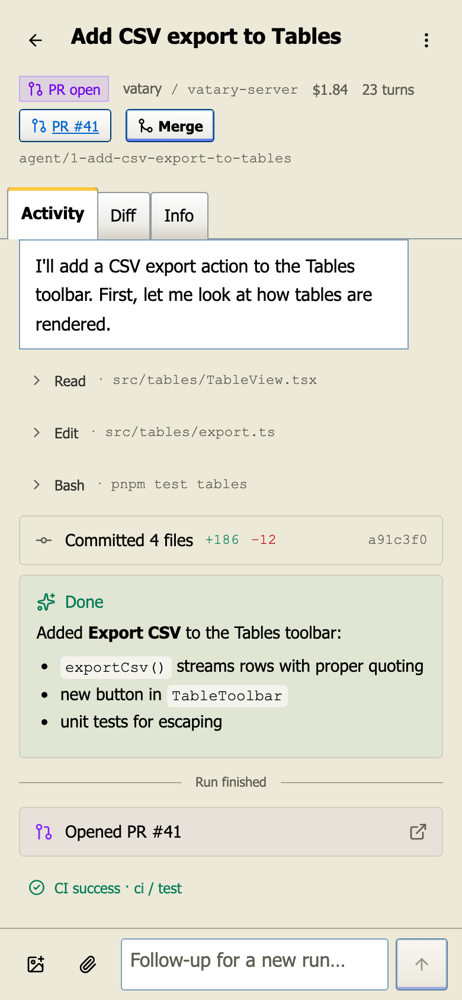

<p align="center"></p>

<h1 align="center">Fleetpocket</h1>

<p align="center"><strong>Run Claude Code on your GitHub repositories from your phone, and get a pull request back.</strong></p>

<p align="center"><a href="https://andrewsl105.github.io/fleetpocket/">Website</a> · <a href="docs/DEPLOY.md">Set it up</a> · MIT license</p>

Describe a change from your phone. Claude Code does the work in an isolated container on your own server, asks you when it needs a decision, and opens a pull request when it's done. You review it whenever you like.

## How it works

1. **Describe the change.** Type it and attach screenshots or files.
2. **Claude works on a new branch.** You can follow every step live.
3. **Answer its questions.** When Claude needs a decision, the task shows its question with answer buttons.
4. **Get a pull request.** You see the summary, the PR and the CI result, and can send a follow-up if something needs changing.

## Steer from wherever you are

- **Install it on your phone**: Fleetpocket is a progressive web app. Add it to your home screen and it opens full screen like a native app.
- **Built for mobile first**: the task board, projects, live progress and answer buttons are laid out for a phone, with a taskbar at the bottom for one-handed use.
- **The same app on desktop**: in any browser, with a Start menu sidebar and the task next to the list, all in a Windows XP look.

## Your keys stay with you

Fleetpocket runs on your server, for one owner: you. Claude works in a sealed container with only the code it was asked to change. It gets no GitHub token, no Docker access and no host network. Your server keeps every key and does the pushing and the pull requests itself. You sign in with a password and a code from your authenticator app.

## Set it up

You need a small Linux server (Ubuntu 24.04 with Docker), a domain, a Claude subscription or Anthropic API key and a GitHub account. Below, `fleetpocket.example.com` stands for your domain.

**1. Point your domain at the server.** Add an A record for `fleetpocket.example.com` and open ports 80 and 443. The HTTPS certificate is issued automatically.

**2. Download Fleetpocket** on the server:

```sh
sudo mkdir -p /srv/fleetpocket/{workspaces,attachments,secrets,backups}
sudo chown "$USER": /srv/fleetpocket
sudo chown -R 1000:1000 /srv/fleetpocket/{workspaces,attachments,secrets}
cd /srv/fleetpocket
curl -fsSLO https://raw.githubusercontent.com/AndrewSl105/fleetpocket/main/deploy/docker-compose.deploy.yml
curl -fsSLO https://raw.githubusercontent.com/AndrewSl105/fleetpocket/main/deploy/Caddyfile
curl -fsSL -o .env https://raw.githubusercontent.com/AndrewSl105/fleetpocket/main/deploy/.env.example
chmod 600 .env
```

**3. Create your login**: a password and an authenticator code.

```sh
docker run --rm -it ghcr.io/andrewsl105/fleetpocket-server:latest hash-password
docker run --rm ghcr.io/andrewsl105/fleetpocket-server:latest totp-setup
```

**4. Connect your accounts.** Each one gives you a few values for `.env`:

- **Claude**: run `claude setup-token` on your computer, or use an Anthropic API key. ([details](docs/DEPLOY.md#4-claude-auth))
- **GitHub**: create your own GitHub App and install it on the repositories Fleetpocket may work on. ([details](docs/DEPLOY.md#5-github-app))

**5. Fill in `.env`** with your domain, the values from steps 3 and 4, and two random secrets. Every variable is described in the file. ([details](docs/DEPLOY.md#2-env))

**6. Start it:**

```sh
docker pull ghcr.io/andrewsl105/fleetpocket-agent:latest
docker compose -f docker-compose.deploy.yml up -d
```

Open `https://fleetpocket.example.com`, sign in, add a repository and start your first task.

**Optional: run tasks on your Mac too.** In Settings → Computers → Add computer, copy one command into the Mac's Terminal and click Connect; then choose per project or per task whether it runs on the server or on your Mac. One login and one task list either way. ([details](docs/DEPLOY.md#11-run-tasks-on-your-own-computer-optional))

To update later, run `docker compose -f docker-compose.deploy.yml pull`, pull the agent image again, then run `up -d`. The full [setup guide](docs/DEPLOY.md) also covers backups and automatic deploys with GitHub Actions.

## Docs

- [Setup guide](docs/DEPLOY.md): server, GitHub App, updates and backups
- [Operations](docs/OPERATIONS.md): health checks, metrics, logs
- [Development](docs/DEVELOPMENT.md): running it locally and contributing

## License

[MIT](LICENSE)

## Screenshots

<table>
  <tr>
    <td><picture><source media="(prefers-color-scheme: dark)" srcset="docs/screenshots/tasks-phone-dark.png"></picture></td>
    <td><picture><source media="(prefers-color-scheme: dark)" srcset="docs/screenshots/task-question-phone-dark.png"></picture></td>
    <td><picture><source media="(prefers-color-scheme: dark)" srcset="docs/screenshots/task-pr-phone-dark.png"></picture></td>
  </tr>
  <tr>
    <td colspan="3"><picture><source media="(prefers-color-scheme: dark)" srcset="docs/screenshots/task-running-desktop-dark.png"></picture></td>
  </tr>
</table>
