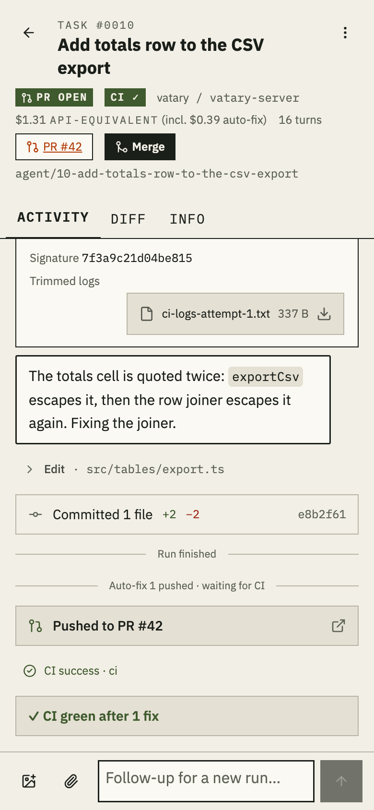
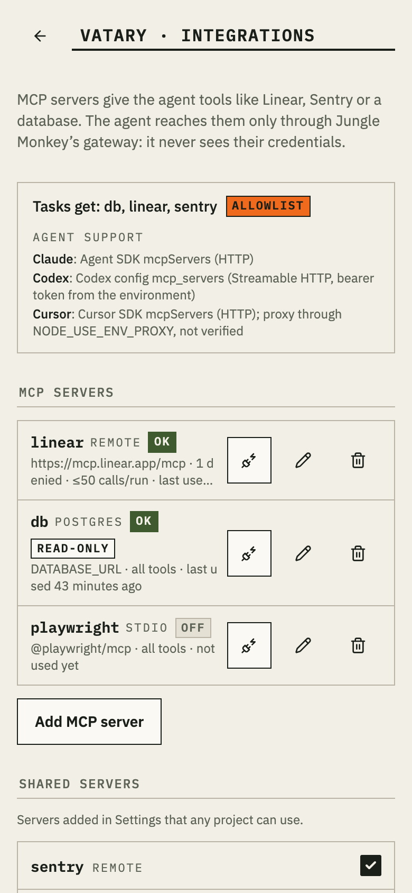
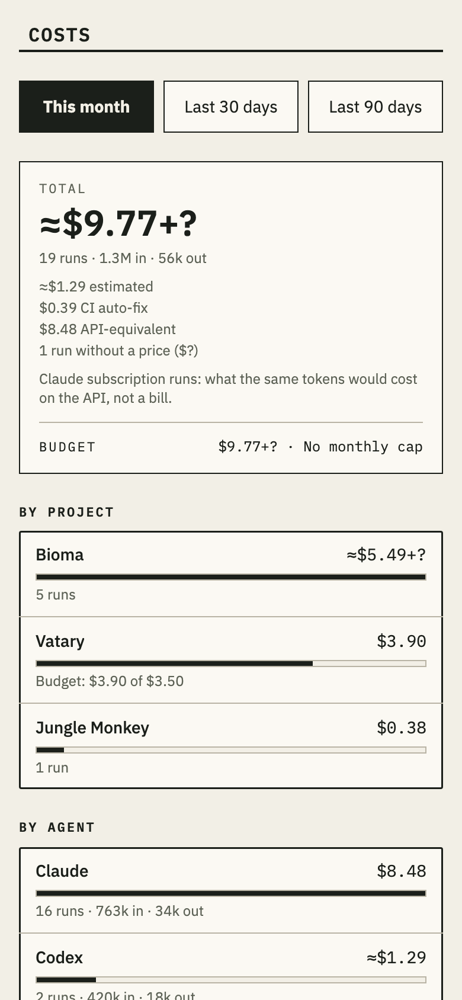
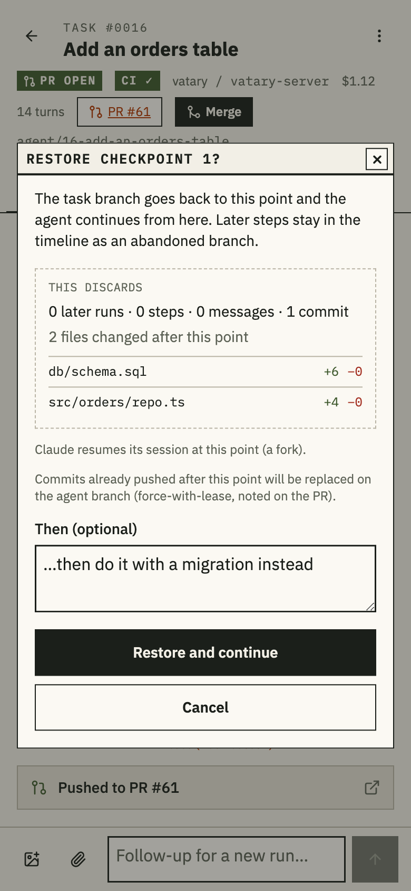
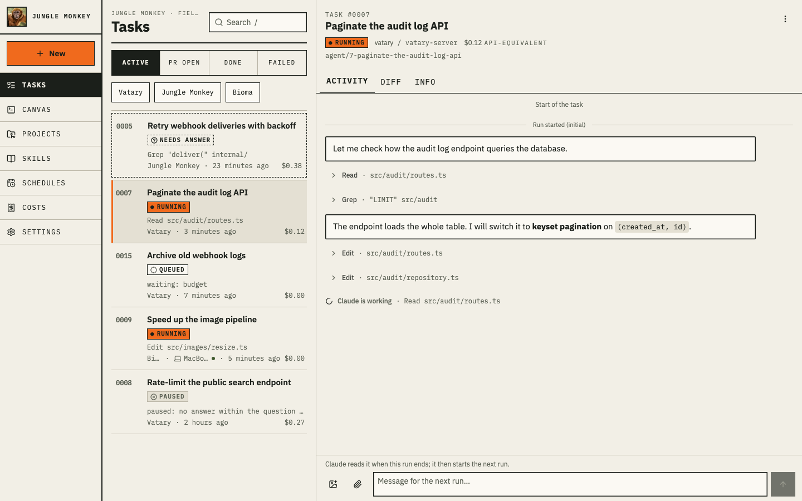

<p align="center"></p>

<h1 align="center">Jungle Monkey</h1>

<p align="center"><strong>Send a coding agent (Claude Code, OpenAI Codex or Cursor) into your repo, answer its questions from your phone, and get a branch or a pull request back.</strong></p>

<p align="center"><a href="https://andrewsl105.github.io/jungle_monkey/"><b>Website</b></a> · <a href="#three-ways-to-install"><b>Install</b></a> · <a href="#docs"><b>Docs</b></a> · <a href="LICENSE"><b>MIT</b></a></p>

## Quick start

```sh
npx jungle-monkey
```

You need Docker running and one agent login or key (Claude, Codex or Cursor). The server, its database and the web app start on your machine and the browser opens, already logged in. The repo you start it in is added for you; add more with `jungle-monkey add [path]`. No domain, no server, no `.env`. Commands, data locations and uninstall: [docs/LOCAL.md](docs/LOCAL.md).

## Three ways to install

1. **On your computer: `npx jungle-monkey`.** Works with repos on your disk and gives you a branch back; connect GitHub to push and open PRs. Needs Docker and an agent login. Stops when the computer sleeps. ([docs/LOCAL.md](docs/LOCAL.md))
2. **On a server in one command.** A 24/7 server, phone (PWA) and Telegram access, your own GitHub App, pull requests and CI. ([docs/DEPLOY.md](docs/DEPLOY.md#quick-setup))
   ```sh
   curl -fsSL https://raw.githubusercontent.com/AndrewSl105/jungle_monkey/main/deploy/install.sh | sh
   ```
3. **Self-hosted, your way.** [`deploy/docker-compose.deploy.yml`](deploy/docker-compose.deploy.yml), [`deploy/cloud-init.yaml`](deploy/cloud-init.yaml) for Hetzner or DigitalOcean, or the fully [manual setup](docs/DEPLOY.md#manual-setup), if you want to control every piece.

| | On your computer | On a server | Self-hosted, your way |
|---|---|---|---|
| Where it runs | your laptop or desktop, in your Docker | a small Linux VPS | wherever you put it |
| GitHub needed? | no: local repos get a branch back; connect GitHub for PRs | yes (your own GitHub App) | yes (your own GitHub App) |
| Phone access | not yet: use a server install | yes: PWA and Telegram | yes: PWA and Telegram |
| Runs 24/7 | no, stops when the computer sleeps | yes | yes |
| Setup time | about a minute | about 10 minutes | as long as you like |

## How it works

1. **Describe the change.** Type it and attach screenshots or files. For a local repo, choose where to start from: the last commit, or including your uncommitted changes.
2. **The agent works on a new branch** in a sealed container. Pick Claude Code, Codex or Cursor per project or per task, and follow every step live.
3. **Answer its questions.** When Claude needs a decision, the task shows its question with answer buttons. Codex and Cursor make their own choices and list open questions in the summary.
4. **Get it back.** From GitHub: a pull request with its CI result. From a local repo: a `jm/<task id>-<slug>` branch in that repo, ready to merge, check out, discard, or push as a PR. Send a follow-up if something needs changing.

## Local repos vs GitHub

| | Local repo | GitHub repo |
|---|---|---|
| Where | a folder on your disk (`npx jungle-monkey`) | a repository your GitHub App can reach (server), or your GitHub login can reach (local) |
| You get back | the branch `jm/<task id>-<slug>` in that repo: `⎇ BRANCH READY` | a pull request: `✓ PR OPEN` |
| Then | Merge into current branch · Check out the branch · Discard · Push & open PR | Merge, follow-ups, CI auto-fix |
| GitHub | optional; "Push & open PR" shows when the repo has a GitHub remote and GitHub is connected | required |
| Connecting GitHub | locally: device flow, `gh auth token` or a fine-grained PAT | server: your own GitHub App |
| CI status | polled | server: GitHub webhooks; local: polled |

## Features

- **Steer from anywhere.** A progressive web app laid out for one hand on the phone, a desktop layout with the task list and open task side by side, and an optional Telegram bot and Mini App that ping you when an agent asks something.
- **CI auto-fix.** A failing check on a Jungle Monkey PR starts a minimal fix from the trimmed CI logs, up to a few attempts and within a budget. A fix that touches CI config or tests waits for your OK; the loop ends as "✓ CI green" or hands back to you with the reason.
- **MCP integrations with an egress allowlist.** Add MCP servers (Linear, Sentry, a database, any npm/pip package or Docker image) per project or globally. The agent reaches them through Jungle Monkey's gateway, which holds the credentials (encrypted at rest), enforces tool lists and call limits and logs every call. Lock a project's network to an allowlist: an egress proxy lets through only the listed hosts, and a blocked host shows up with a one-tap "Allow".
- **Costs and budgets.** Every run records its tokens and cost: reported by Claude (marked API-equivalent on a subscription), estimated from an editable price table for Codex and Cursor (`≈$0.84`). The Costs screen totals them by project, agent and day with a CSV export; monthly caps per project or overall hold new runs at 100% (running ones finish), with a notice at 80% and a one-tap "Start anyway".
- **Canvas node view.** Every running task as a live node: what it is doing now, its activity lanes (read, web, edit, shell, git), the files it touched, its time and cost. Switch any node to a plain terminal.
- **Remote computers.** Add your Mac in Settings → Computers (it runs `fleetpocket-node`) and choose per project or per task whether a task runs on the server or on it. ([details](docs/DEPLOY.md#11-run-tasks-on-your-own-computer-optional))
- **Checkpoints.** Turn them on and every agent step that changes files is saved. Tap "Restore here" on any step, see what it discards, add "…then do it with a migration instead", and the agent continues from there. Discarded steps stay in the timeline as an abandoned branch.
- **Schedules and loops.** A schedule starts a task on a timetable (daily, weekdays, weekly or any cron, in your time zone) with its own per-run and monthly budget: nightly dependency updates, weekday lint fixes. Run one now, pause or duplicate it from the Schedules screen or Telegram's `/schedules`. Any task can also loop until a check passes: after each run Jungle Monkey runs your check (`npm test`, `go test ./...`) in the same container and hands the agent the failing output, up to a few iterations and a budget; the PR (or the local branch) arrives once, at the end.
- **Skill library.** Keep your playbooks as skills (`SKILL.md` folders: instructions plus templates) and tick which ones each project's tasks get; a task can add or drop one in the composer. Four diagram skills come with it (database schema, C4, sequence flow, infrastructure map), off until you enable them; import a `SKILL.md` or `.zip`, edit, duplicate or export any of them.

## Your keys stay with you

Jungle Monkey runs for one owner: you. The agent works in a sealed container with only the code it was asked to change. It gets no GitHub token, no Docker access and no host network. Jungle Monkey keeps every key and does the pushing and the pull requests itself, after checking the diff (no `.github/` changes, size limits, a secrets scan). MCP credentials stay in the gateway; with an allowlist, the container's only way out is the egress proxy. On a server you sign in with a password and a code from your authenticator app; locally, the CLI opens a one-time login link on `127.0.0.1`.

## Docs

- [Local mode](docs/LOCAL.md): `npx jungle-monkey`, commands, data, uninstall
- [Setup guide](docs/DEPLOY.md): server, GitHub App, updates and backups
- [Operations](docs/OPERATIONS.md): health checks, metrics, logs
- [Development](docs/DEVELOPMENT.md): running it from source and contributing
- Reference: [server spec](docs/SPEC-server.md), [web spec](docs/SPEC-web.md), [API](docs/API.md), [runner protocol](docs/PROTOCOL.md), [decisions](docs/DECISIONS.md)

**Updating a server**: run the installer again. It keeps your `.env`, adds new settings, pulls the new images and restarts. Internal names (`fleetpocket-*` images, `/srv/fleetpocket`, `FLEETPOCKET_*` variables) are unchanged by the rename.

## License

[MIT](LICENSE)

## Screenshots

<table>
  <tr>
    <td><picture><source media="(prefers-color-scheme: dark)" srcset="docs/screenshots/tasks-phone-dark.png"></picture></td>
    <td><picture><source media="(prefers-color-scheme: dark)" srcset="docs/screenshots/task-question-phone-dark.png"></picture></td>
    <td><picture><source media="(prefers-color-scheme: dark)" srcset="docs/screenshots/task-ci-green-phone-dark.png"></picture></td>
  </tr>
  <tr>
    <td><picture><source media="(prefers-color-scheme: dark)" srcset="docs/screenshots/integrations-phone-dark.png"></picture></td>
    <td><picture><source media="(prefers-color-scheme: dark)" srcset="docs/screenshots/costs-phone-dark.png"></picture></td>
    <td><picture><source media="(prefers-color-scheme: dark)" srcset="docs/screenshots/restore-checkpoint-phone-dark.png"></picture></td>
  </tr>
  <tr>
    <td colspan="3"><picture><source media="(prefers-color-scheme: dark)" srcset="docs/screenshots/task-running-desktop-dark.png"></picture></td>
  </tr>
</table>
