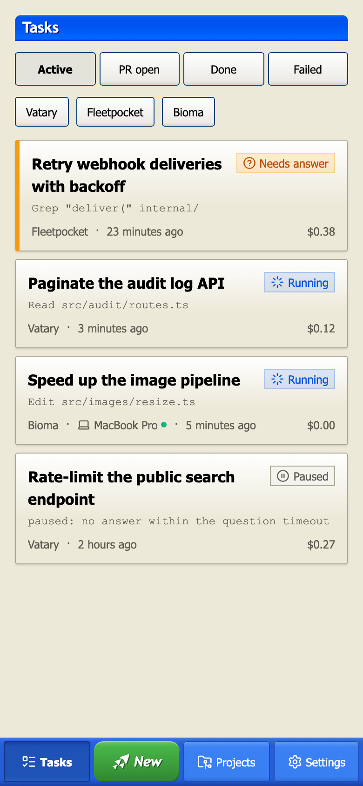

<p align="center"></p>

<h1 align="center">Jungle Monkey</h1>

<p align="center"><strong>Send a coding agent (Claude Code, OpenAI Codex or Cursor) into your repo. Answer its questions from your phone. Get a pull request back.</strong></p>

<p align="center"><a href="https://andrewsl105.github.io/jungle_monkey/">Website</a> · <a href="#three-ways-to-install">Install</a> · <a href="docs/DEPLOY.md">Docs</a> · <a href="LICENSE">MIT</a></p>

## Quick start

```sh
npx jungle-monkey
```

You need Docker running and one agent login or key (Claude, Codex or Cursor). The server, its database and the web app start on your machine and the browser opens, already logged in. No domain, no server, no `.env`. Commands, data locations and uninstall: [docs/LOCAL.md](docs/LOCAL.md).

## Three ways to install

1. **On your computer: `npx jungle-monkey`.** One binary with an embedded database and the web app, running tasks in your Docker. Needs Docker and an agent login. Stops when the computer sleeps. ([docs/LOCAL.md](docs/LOCAL.md))
2. **On a server in one command.** A 24/7 server you reach from your phone (PWA or Telegram), with your own GitHub App, pull requests and CI results. ([docs/DEPLOY.md](docs/DEPLOY.md#quick-setup))
   ```sh
   curl -fsSL https://raw.githubusercontent.com/AndrewSl105/jungle_monkey/main/deploy/install.sh | sh
   ```
3. **Self-hosted, your way.** [`deploy/docker-compose.deploy.yml`](deploy/docker-compose.deploy.yml), [`deploy/cloud-init.yaml`](deploy/cloud-init.yaml) for Hetzner or DigitalOcean, or the fully [manual setup](docs/DEPLOY.md#manual-setup), if you want to control every piece.

| | On your computer | On a server | Self-hosted, your way |
|---|---|---|---|
| Where it runs | your laptop or desktop | a small Linux VPS | wherever you put it |
| GitHub needed? | not to start | yes (your own GitHub App) | yes (your own GitHub App) |
| Phone access | through your own tunnel | yes: PWA and Telegram | yes: PWA and Telegram |
| Runs 24/7 | no, stops when the computer sleeps | yes | yes |
| Setup time | about a minute | about 10 minutes | as long as you like |

## How it works

1. **Describe the change.** Type it and attach screenshots or files.
2. **The agent works on a new branch.** Pick Claude Code, Codex or Cursor per project or per task, and follow every step live.
3. **Answer its questions.** When Claude needs a decision, the task shows its question with answer buttons. Codex and Cursor make their own choices and list open questions in the summary.
4. **Get a pull request.** Read the summary, the PR and the CI result, and send a follow-up if something needs changing.
5. **Get it back green** (optional). Turn on CI auto-fix and a failing check starts a minimal fix from the trimmed CI logs, up to a few attempts. A fix that touches CI config or tests waits for your OK.
6. **Give it your tools, not your keys** (optional). Add MCP servers (Linear, Sentry, a database, any npm/pip package or image) per project: the agent reaches them through Jungle Monkey's gateway, which holds the credentials, enforces tool lists and call limits and logs every call. Lock a project's network to an allowlist and blocked hosts show up with a one-tap "Allow".
7. **Know what it costs** (optional caps). Every run records its tokens and cost: reported by Claude (marked API-equivalent on a subscription), estimated from an editable price table for Codex and Cursor (`≈$0.84`). The Costs screen totals them by project, agent and day with a CSV export; monthly caps per project or overall hold new runs at 100% (running ones finish) with a notice at 80% and a one-tap "Start anyway".
8. **Roll back a step** (optional). Turn on checkpoints and every agent step that changes files is saved. Tap "Restore here" on any step, see what it discards, add "…then do it with a migration instead", and the agent continues from there: Claude resumes its own conversation at that point, Codex and Cursor start from a summary. Discarded steps stay in the timeline as an abandoned branch, and already-pushed commits are replaced on the agent's branch with force-with-lease.

## Local repos vs GitHub

The server install works on GitHub repositories through your own GitHub App: it clones, pushes the task branch and opens the pull request. Local mode (`npx jungle-monkey`) runs the same server and agents on your computer; connecting GitHub there and delivering a branch back into a folder on your disk are not built yet, so task commits stay in the local workspace for now. [docs/LOCAL.md](docs/LOCAL.md) tracks what works today.

## Features

- **Steer from anywhere.** A progressive web app laid out for one hand on the phone, a desktop layout with the task list and open task side by side, and an optional Telegram bot and Mini App that ping you when an agent asks something.
- **Canvas node view.** Every running task as a live node with its activity lanes (read, web, edit, shell, git), the files it touched, its time and cost, or as a plain terminal.
- **Costs.** Cost per run on every task, and today's and this month's totals in Settings.
- **Remote computers.** Add your Mac in Settings → Computers and choose per project or per task whether a task runs on the server or on it. ([details](docs/DEPLOY.md#11-run-tasks-on-your-own-computer-optional))
- **Skills.** A library of reusable instructions, enabled per project, that the agent receives with each task.

## Your keys stay with you

Jungle Monkey runs for one owner: you. The agent works in a sealed container with only the code it was asked to change. It gets no GitHub token, no Docker access and no host network. Your server keeps every key and does the pushing and the pull requests itself. On a server you sign in with a password and a code from your authenticator app; locally, the CLI opens a one-time login link on `127.0.0.1`.

## Docs

- [Local mode](docs/LOCAL.md): `npx jungle-monkey`, commands, data, uninstall
- [Setup guide](docs/DEPLOY.md): server, GitHub App, updates and backups
- [Operations](docs/OPERATIONS.md): health checks, metrics, logs
- [Development](docs/DEVELOPMENT.md): running it from source and contributing

**Updating a server**: run the installer again. It keeps your `.env`, adds new settings, pulls the new images and restarts. Internal names (`fleetpocket-*` images, `/srv/fleetpocket`, `FLEETPOCKET_*` variables) are unchanged by the rename.

## License

[MIT](LICENSE)

## Screenshots

<table>
  <tr>
    <td><picture><source media="(prefers-color-scheme: dark)" srcset="docs/screenshots/tasks-phone-dark.png"></picture></td>
    <td><picture><source media="(prefers-color-scheme: dark)" srcset="docs/screenshots/task-question-phone-dark.png"></picture></td>
    <td><picture><source media="(prefers-color-scheme: dark)" srcset="docs/screenshots/task-pr-phone-dark.png"></picture></td>
  </tr>
  <tr>
    <td colspan="3"><picture><source media="(prefers-color-scheme: dark)" srcset="docs/screenshots/task-running-desktop-dark.png"></picture></td>
  </tr>
</table>
